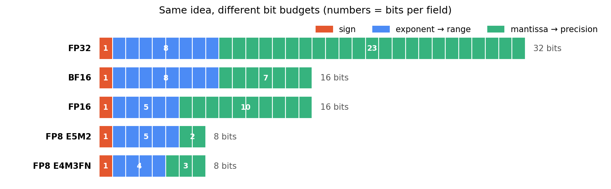
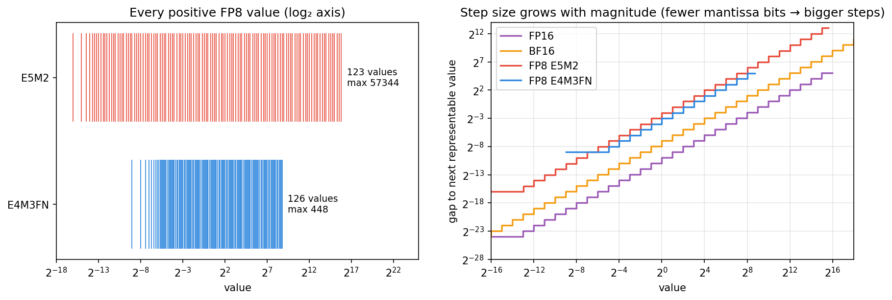
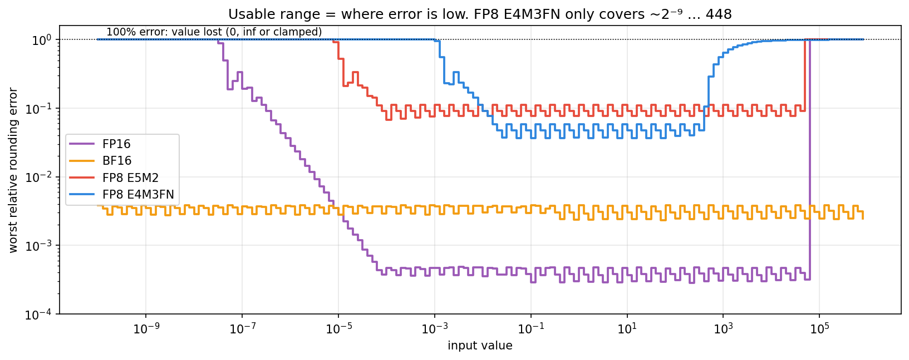
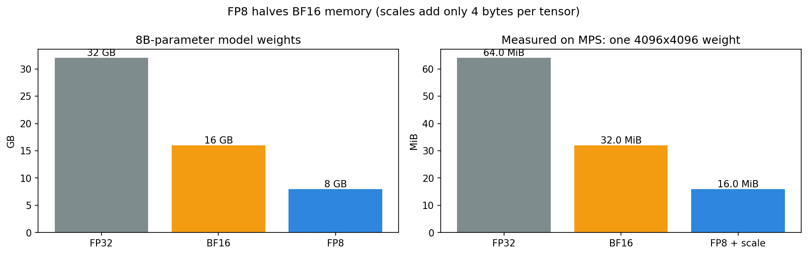
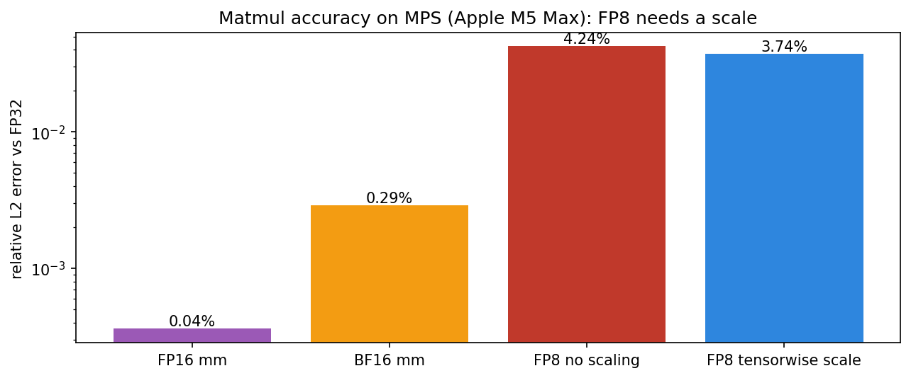
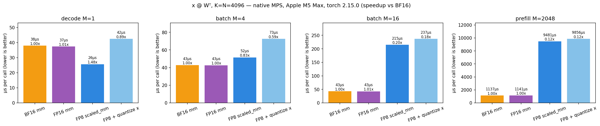
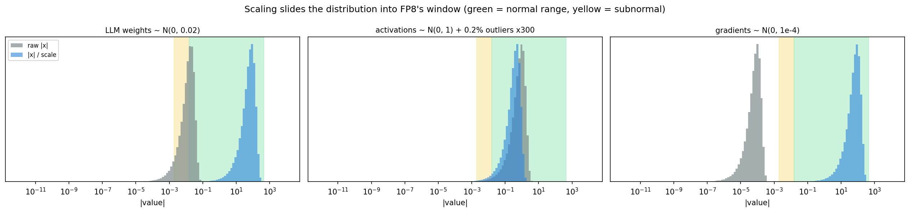
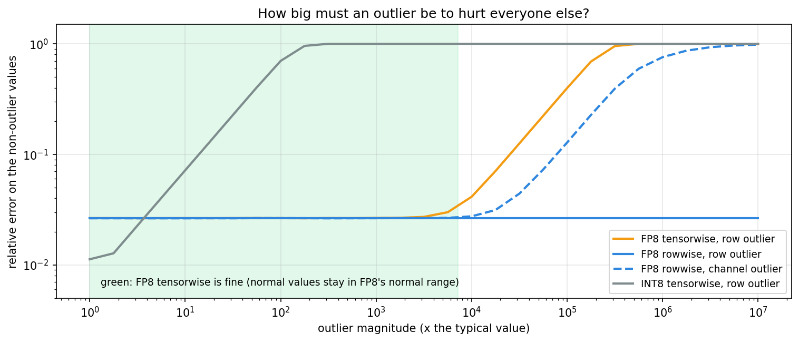
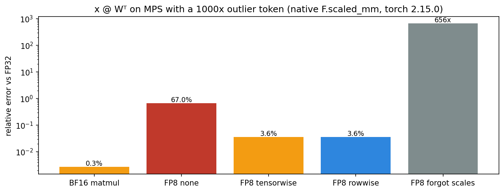
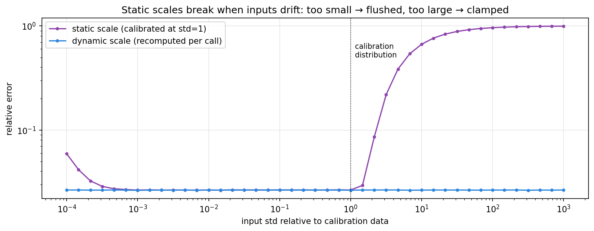

# Learning FP8 on Apple Silicon with PyTorch 2.15

A notebook-driven walkthrough of FP8 (`float8_e4m3fn`) on MPS in PyTorch 2.15: what the format is, what this
machine actually supports, how scaling works, and what FP8 buys you in memory, accuracy and speed.

```bash
make install
uv run --with jupyter jupyter lab notebooks/   # or open the .ipynb files in VS Code
```

| Notebook | Topic |
| --- | --- |
| [`01_fp8_basics.ipynb`](notebooks/01_fp8_basics.ipynb) | Sign/exponent/mantissa, `e4m3fn` vs `e5m2`, rounding, MPS support matrix, what's new in 2.15, impact |
| [`02_scaling.ipynb`](notebooks/02_scaling.ipynb) | Why scales are needed, tensorwise vs rowwise, outliers, `F.scaled_mm` scales, static vs dynamic |

All numbers below were measured on an **Apple M5 Max, macOS 26.7.1, torch 2.15.0**, natively on MPS
(no CPU fallback). Re-run the notebooks to regenerate them for your machine.

## 1. What FP8 is

Every float is `(-1)^sign × 2^(exponent − bias) × 1.mantissa`. Formats differ only in how they split the bits:
exponent bits buy **range**, mantissa bits buy **precision**.



With 3 mantissa bits, E4M3FN has only 8 values per power of 2, so the gap between neighbours doubles every octave.
"FN" = *finite*: no infinity, a single NaN code, which stretches the max from 240 to **448**.



The usable window is where rounding error is low: roughly **2⁻⁹ … 448** for E4M3FN at ~6% worst-case error.
Below it values flush to 0; above it `.to(float8_e4m3fn)` silently **clamps** to 448.



## 2. What 2.15 actually added

FP8 itself isn't new: the dtypes arrived in 2.1 and `F.scaled_mm` / `_scaled_mm_v2` in 2.10. **2.15 adds MPS
kernels** for them ([#194074](https://github.com/pytorch/pytorch/pull/194074),
[#196916](https://github.com/pytorch/pytorch/pull/196916)).

| On MPS (2.15) | `float8_e4m3fn` | `float8_e5m2` |
| --- | --- | --- |
| Tensors on `mps` (cast, copy, cat, gather, ...) | ✅ | ❌ `Undefined type` (no upstream work yet) |
| Elementwise math (`+`, `*`, `<`) | ❌ only `==`/`!=` (by design: upcast first) | ❌ |
| `F.scaled_mm`, TensorWise / RowWise, FP32 scales | ✅ | ❌ |
| Block-wise / MX scaling | ❌ | ❌ |
| Legacy `torch._scaled_mm` | ❌ not registered for MPS | ❌ |

FP8 is decoded to float in software inside the Metal kernels, so it saves **bandwidth**, not compute.

## 3. Impact

**Memory:** exactly half of BF16; a scale is just 4 bytes.



**Accuracy:** about 10x more matmul error than BF16 (~3.7% vs ~0.3%), so validate per model.



**Speed:** FP8 wins **only for single-row decode** (~1.5x vs BF16 with pre-quantized inputs). Quantizing the
activation on every call erases that win. At M ≥ 16 and in prefill, the generic FP8 kernel is **5–8x slower** than
Apple's tuned BF16 matmul.



## 4. Scaling

A scale (`amax / 448`, stored in FP32 next to the FP8 tensor) slides any distribution into FP8's window. Without
one, gradients flush to 0, outlier activations clamp, and small weights lose precision.



**Granularity.** Because FP8 is floating point, it tolerates outliers far better than INT8: one tensorwise scale
holds ~2.6% error until an outlier is ~3,000x the typical value, while INT8 collapses at ~60x. **Rowwise** scales
isolate a row/token outlier of any size. A channel outlier sits in every row, so rowwise can't isolate it.



**In `F.scaled_mm`.** Pass the decode scales (`[]` tensorwise, `[M,1]` / `[1,N]` rowwise). They're applied after
FP32 accumulation, and the native result matches dequantize-then-matmul (~2e-6). Forgetting them is off by
`1 / (scale_a · scale_b)`.



**Static vs dynamic.** A static scale (calibrated once) is free at runtime and fine for weights, but breaks when
inputs drift. A dynamic scale adapts but costs an `amax` reduction per call.



PyTorch core doesn't choose scales for you. You compute them, or use a library such as
[torchao](https://github.com/pytorch/ao) (not yet tested on MPS here).

## Requirements

Python **3.11+**, PyTorch **2.15**, Apple Silicon with **macOS 15+**.

Sources: [2.15 release blog](https://pytorch.org/blog/pytorch-2-15-release-blog/),
[release notes](https://github.com/pytorch/pytorch/releases/tag/v2.15.0),
[MPS ScaledMM kernel](https://github.com/pytorch/pytorch/blob/v2.15.0/aten/src/ATen/native/mps/operations/ScaledMM.mm),
[Metal float8 type](https://github.com/pytorch/pytorch/blob/v2.15.0/c10/metal/float8.h).
